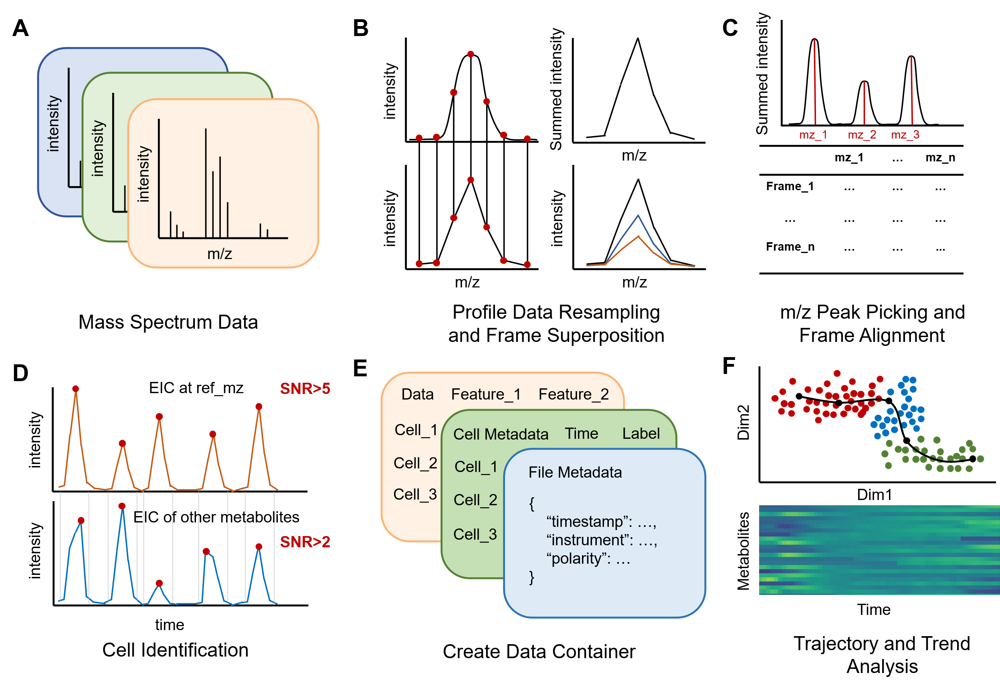
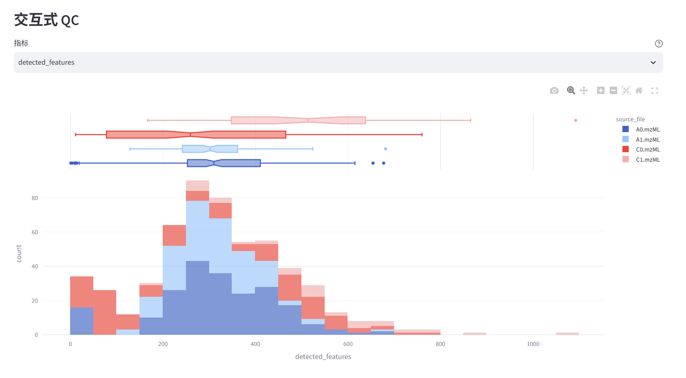
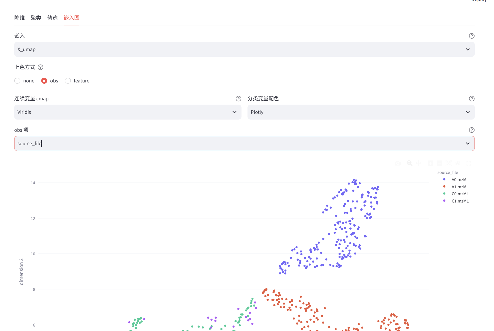
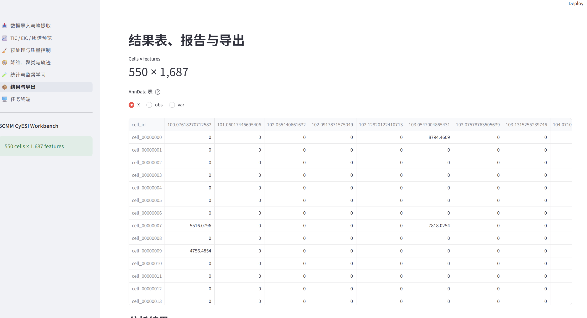

# SCMM-GUI 0.3.0

A local web workbench for CyESI single-cell mass spectrometry, from scan-level signals to annotated cell-by-feature matrices and statistical analysis. The Python package is named `scMM`.

## Background

Cellular electrospray ionization mass spectrometry (CyESI-MS) measures metabolic signals from individual cells and provides a route to studying cellular metabolic heterogeneity. The method was introduced by Yao and colleagues in *Analytical Chemistry*. [CyESI method paper](https://doi.org/10.1021/acs.analchem.9b01419)

SCMM connects mass-spectral processing with cell-level analysis. It constructs an m/z feature axis from summed MS1 spectra, locates cell events using reference-ion extracted ion chromatograms, and extracts feature intensities for the detected cell frames. The original software workflow was reported in a study of continuous single-cell monitoring of microalgal oxidative-stress responses. Version 0.3.0 extends that workflow with an interactive browser interface, reversible filtering, compound annotation, and configurable visualization. [Original SCMM workflow paper](https://doi.org/10.1021/acs.analchem.6c04519)



*Processing workflow from the SCMM usage guide by 赵泊雅. Signal and detection thresholds are configurable in the application.*

## Download and start

Download [SCMM_GUI_0.3.0.zip](https://github.com/creeper349/scMM/raw/refs/heads/main/release/SCMM_GUI_0.3.0.zip) and extract the complete folder. The distribution contains Python source, configuration files, documentation, and Windows setup and launch scripts. Previous distributions are available in [release/](https://github.com/creeper349/scMM/tree/main/release).

### Windows quick start

1. Install **64-bit Python 3.11** or **Miniconda**. For Python, enable **Add python.exe to PATH** during installation.
2. Open the extracted `SCMM_GUI_0.3.0` folder and run `setup_scmm.cmd`.
3. Choose whether to install the optional Thermo RAW reader when prompted. The installer presents the official reader license.
4. Run `start_scmm.cmd`. Open **http://127.0.0.1:8501** in the browser and keep the launch terminal running during analysis.

From PowerShell in the software folder, the same steps are available as commands.

```powershell
.\setup_scmm.cmd
.\start_scmm.cmd
```

The setup script creates or reuses `.scmm-env`, installs missing dependencies, and can use an existing Python or Conda installation. Error messages remain visible in the terminal. The read-only environment check is available with `setup_scmm.cmd --check`.

Thermo RAW access uses `pythonnet` and the official Thermo Fisher Scientific RawFileReader assemblies. On Windows, the supplied Net471 assemblies require .NET Framework 4.7.1 or later. mzML and mzXML inputs are read through pyOpenMS.

See the [Windows installation guide](INSTALL_SCMM_GUI.md) and the [bilingual setup and usage guide](WINDOWS_SETUP_AND_USAGE_BILINGUAL.md) for installation, upgrades, optional components, and troubleshooting.

### 中文快速开始

首次使用时，先安装 64 位 Python 3.11 或 Miniconda，再完整解压发行包，依次运行 `setup_scmm.cmd` 和 `start_scmm.cmd`。配置脚本复用已有环境并补齐缺失依赖，Thermo RAW 读取组件在用户选择安装后配置。浏览器访问 `http://127.0.0.1:8501`。

已经安装过 SCMM 的电脑，可先备份分析结果和自定义参数，将新版本源码更新到原软件目录，保留 `.scmm-env`，再运行一次 `setup_scmm.cmd` 和 `start_scmm.cmd`。自定义默认参数位于 `scMM/config/defaults.json`，更新后可按需合并到新配置中。详细步骤见[安装与更新说明](INSTALL_SCMM_GUI.md)。

## Analysis workflow

### Import MS data and detect cells

- Read **mzML**, **mzXML**, or **Thermo RAW**, or reopen a processed **H5AD** dataset.
- Process a single file or a directory of files. Choose a shared m/z axis across files, or extract each file independently and merge features within a ppm tolerance.
- Set the m/z range, instrument resolution, resampling density, reference ions, baseline windows, and signal thresholds.
- Combine several reference ions by union or intersection. Reference-ion matching uses the specified ppm tolerance.
- Preserve `source_file` and the original zero-based `frame_id` for each cell. MS1 frames supply the cell-by-feature matrix.

### Inspect signals and perform quality control

Inspect TIC, EIC, MS1 spectra, cell-extraction previews, summed spectra, and retained features. EIC views can overlay the detected cell frames for the selected source file.

Quality control includes detected-feature counts, original total intensities, per-file distributions, and pseudobulk comparisons. Cell and feature filters use reversible keep flags, with `1` for retained and `0` for ignored. Two-dimensional gating supports embedding coordinates, numeric cell metadata, feature intensities, and density colouring.



*Quality-control interface example from the SCMM usage guide.*

### Preprocess, embed, cluster, and order cells

Normalization, standardization, and imputation are available from the GUI. Matrix layers preserve alternative processing results, and the sidebar selects the layer used for subsequent calculations.

| Analysis | Available methods and outputs |
| --- | --- |
| Normalization and transformation | Total intensity, maximum, quantile, PQN, z-score, log, and min–max |
| Imputation | Configurable methods including KNN and constant filling |
| Dimensionality reduction | PCA, UMAP, t-SNE, Isomap, and LLE |
| Clustering | KMeans, hierarchical, DBSCAN, Leiden, and Louvain, with labels written to `obs` |
| Trajectory analysis | Diffusion pseudotime, kNN graph geodesic, PCA pseudotime, and PAGA-like cluster-graph pseudotime |
| Embedding visualization | Colour by `obs` metadata or feature intensity, with configurable cmap and continuous colour scales |

Pseudotime values are stored in `obs`; diffusion components are stored in `obsm["X_diffmap"]`. Other embeddings are stored under their corresponding `obsm` keys.



*Embedding interface example from the SCMM usage guide. The GUI exposes the embedding, colour source, metadata key, and colour palette.*

### Identify and annotate compounds

- Run the built-in deisotope procedure with configurable isotope spacing, abundance, ppm tolerance, and regression criteria.
- Match multiple MS1 databases and MS/MS libraries, with acquisition polarity and adduct selection.
- Collect precursor-matched MS2 scans from multiple DDA or PRM acquisitions in RAW, mzML, or mzXML format.
- Review candidate names, formulas, theoretical and observed m/z, ppm errors, isotope similarity, MS/MS similarity, and matched fragments in a dynamically loaded table.
- Compare measured and library MS/MS in a mirror-spectrum dialog.
- Select source MS files and sample cell frames to construct an annotation-supporting summed spectrum. Click a feature ID to locate its peak and associated isotope peaks.
- Accept individual candidates, all candidates, or the first candidate per feature. Use a field-mapping table to write selected annotation metrics to named `var` columns.
- Import CSV/Excel annotations by feature order, feature ID, var metadata, or ppm-based m/z matching. Select records and map several fields in one operation.

Regular lipids can be reported at sum-composition level. Candidate and representative-spectrum information remains available for review. See the [compound annotation guide](ANNOTATION_GUIDE.md) and [lipid nomenclature guide](LIPID_NOMENCLATURE.md) for formats, naming rules, scoring, and acceptance behaviour.

### Compare groups and build models

Untargeted differential analysis provides statistical tests, BH-FDR correction, FC, and up/down summaries. Targeted comparisons provide violin/box plots, optional individual points, configurable zero-value handling, and group-comparison tests.

The volcano plot uses continuous log2-FC colour and **−log10(FDR)** for both vertical position and point size. Choose a `var` field for labels, set label font size and count, or click points to toggle labels. Matplotlib export uses the current annotations and connects each label to its feature point.

Additional analyses include hierarchical heatmaps, feature-correlation networks, regression with confidence intervals and permutation p-values, and supervised classification with LDA, PLS-DA, logistic regression, and random forests. Model evaluation includes cross-validation, R²/Q², ROC and precision–recall curves, calibration, and SHAP visualization. Optional SMOTE is fitted inside the training/CV pipeline.

Venn and UpSet plots compare feature or compound sets grouped by any selected `obs` key. For annotated-compound sets, select the `var` annotation column or accepted library candidates. Empty annotations and isotope features are filtered before counting. Grouped compound-class composition can be displayed as counts or percentages.

### Inspect and export results

The results page provides dynamically loaded cell-by-feature tables with optional frozen metadata headers. Save the dataset as H5AD and export tables or reports. Plot dialogs provide Matplotlib previews and PNG/SVG saving through a local file chooser. SVG exports preserve text objects.



*Results interface example from the SCMM usage guide. Version 0.3.0 also provides dynamically loaded tables and selectable frozen metadata headers.*

## Data model

| AnnData field | Contents |
| --- | --- |
| `X` | Matrix selected for current analysis |
| `layers` | Raw intensities and alternative preprocessing results |
| `obs` | Cell metadata, source file, original frame ID, QC metrics, keep flags, clusters, and pseudotime |
| `var` | Feature m/z, keep flags, isotope assignments, and annotation fields |
| `obsm` | Cell embeddings and diffusion components |
| `uns` | Processing settings, source metadata, summed spectra, and annotation evidence |

## Python and command-line use

The source distribution also exposes the processing API and CLI.

```python
from scMM import CyESIData

data = CyESIData.load_from_file(
    r"D:\SCMM_DATA\example.mzML",
    reference_mz=[734.5929],
    mz_range=(100.0, 1000.0),
    ppm_tol=5.0,
)
data.save("results/example.h5ad")
data.export_csv("results/csv")
```

Replace the example path and reference ion with values appropriate for the acquisition.

```powershell
scmm process sample.mzML results/sample.h5ad --reference-mz 734.5929
scmm inspect results/sample.h5ad
scmm export results/sample.h5ad results/csv
```

For development, install the editable package and run the tests.

```powershell
python -m pip install -e ".[web,ml,dev]"
python -m pytest -q
```

## Citation

When using SCMM for research, cite the original software workflow and the CyESI method.

1. Qiao, Y.; Zhao, B.; Cheng, R.; Peng, Y.; Ma, X.; Zhang, S. Twelve-Hour Dynamic Monitoring of Microalgae Response to Oxidative Stress by Single-Cell Metabolomics Analysis. *Analytical Chemistry* **2026**, *98* (44), 31041–31051. [DOI 10.1021/acs.analchem.6c04519](https://doi.org/10.1021/acs.analchem.6c04519)
2. Yao, H.; Zhao, H.; Zhao, X.; Pan, X.; Feng, J.; Xu, F.; Zhang, S.; Zhang, X. Label-free Mass Cytometry for Unveiling Cellular Metabolic Heterogeneity. *Analytical Chemistry* **2019**, *91* (15), 9777–9783. [DOI 10.1021/acs.analchem.9b01419](https://doi.org/10.1021/acs.analchem.9b01419)

## Support

Report reproducible issues through the [GitHub issue tracker](https://github.com/creeper349/scMM/issues). Include the software version, input format, relevant settings, and the terminal traceback.
